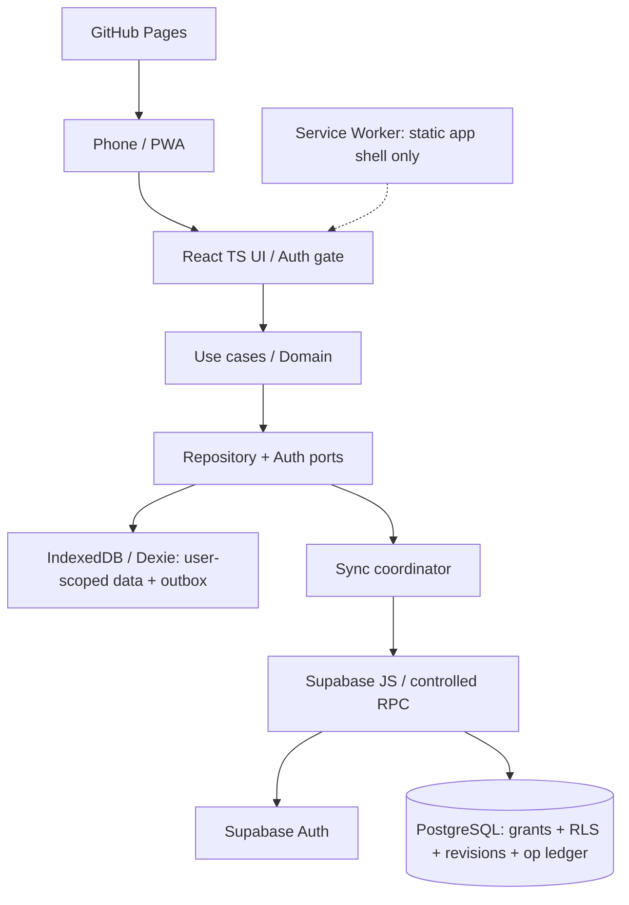

# Architecture — Workout Tracker v0.5 (auth-required / local-first / closed personal pilot)

**Status:** архитектурная спецификация; React-кода пока нет. Договорённости: offline-before-gym-launch (ADR 0002), private accounts required (ADR 0006), unverified-email personal pilot (ADR 0007). До Plan 004 не считать готовым.

## Компоненты

## Фундаментальные границы
- **Обязательная идентичность на публичном релизе:** пользователь без входа видит экран входа; регистрация доступна **только в открытое владельцем окно onboarding**, затем закрывается на стороне Supabase. Никакого персонального журнала до входа. Первый вход онлайн.
- **После входа:** IndexedDB привязана к стабильному `auth.uid()` пользователя, не к email. Ранее зарегистрированный пользователь, который не вышел на этом устройстве, может работать с локальным кешем офлайн, но sync приостановлен до проверки сессии онлайн.
- **Plan 002:** локальная тестовая identity/workspace для разработки без Supabase, не общедоступный гостевой продукт; будущие реальные записи не загружаются из него автоматически.
- **Запись:** одна IndexedDB транзакция сохраняет запись и операцию в outbox; без ожидания сети.
- **Облако:** Supabase Auth для identity, Postgres RLS/grants для авторизации каждой операции. Нельзя заменять базовые политики скрытой кнопкой интерфейса.
- **На выходе/переключении:** предыдущий пользовательский кеш скрыт, outbox нельзя отправить от имени другого пользователя; при pending предупредить и предложить безопасный вариант.

## Папки
- `src/app`: роутинг, `AuthGate`, композиция, состояния сети/синхронизации.
- `src/features`: active workout, history, exercises, progress; auth screens.
- `src/domain`: типы и вычисления без React.
- `src/data/ports`: контракты репозиториев/Auth/session.
- `src/data/local`: Dexie + user-scoped outbox.
- `src/data/cloud`: Supabase Auth/DB adapters, контролируемый RPC.
- `src/data/sync`: coordinator, retries, server ack, conflicts.
- `src/shared`: дизайн-система, базовые компоненты, доступность.
- `src/test`: тестовые фабрики, mocks.

**Зависимости:** UI/features → domain + data ports → adapters. Не импортировать Supabase и Dexie напрямую из экранов.

## Маршруты и публикация
- GitHub Pages: Vite `base` под `/<repo>/`, `HashRouter` (`/#/workout`, `/#/history`, `/#/auth/login`).
- Auth callbacks и разрешённые redirect URLs на localhost/Pages проверить отдельно; URL и PKCE/OAuth flow должны соответствовать выбранному способу входа.
- Service Worker кэширует только публичные HTML/JS/CSS/assets; запрет на кеш Supabase API/Auth/JWT и пользовательских данных.
- Никакого backend-сервера на Plan 001–004, если безопасность sync RPC удаётся обеспечить в Supabase.

## План / выпуск
| Plan | Результат | Статус использования |
| --- | --- | --- |
| 001 | Демо-экран активной тренировки, без persistence/auth | только UI-проверка |
| 002 | IndexedDB, PWA shell, export/import, offline tests с тестовым локальным профилем | только dev/test, не публичный релиз |
| 003 | Supabase Auth, обязательный login, privacy/RLS, owner-scoped workspace, basic sync | закрытый тест: email/password без подтверждения, затем запрет новых signup |
| 004 | Надёжные повторы, конфликты, retry/ack, account switch, cross-user/offline tests | только после DoD — первый закрытый личный пилот; не открытая регистрация |
| 005 | Прогресс, графики | позже |

## Синхронизация
Стабильные entity/operation UUID, user scoped outbox, атомарные записи, серверные revision, idempotent operation ledger и tombstones. Конфликт не стирает обе версии. `offline-sync.md` содержит fault-tests.

## Документация
См. `docs/architecture/auth.md`, `security.md`, `data-model.md`, `offline-sync.md`; `docs/operations/supabase-private-pilot.md`, `docs/quality/acceptance.md`; ADR 0006/0007.
