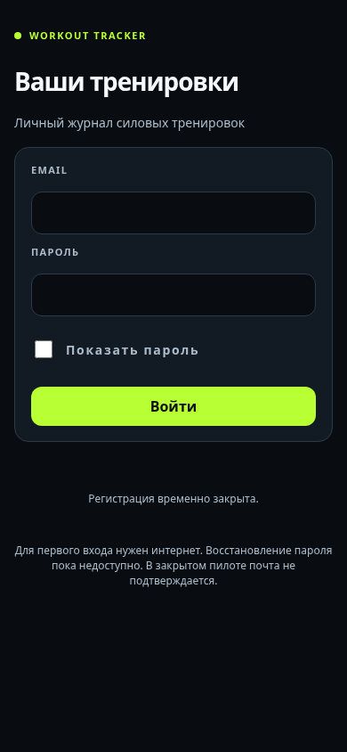
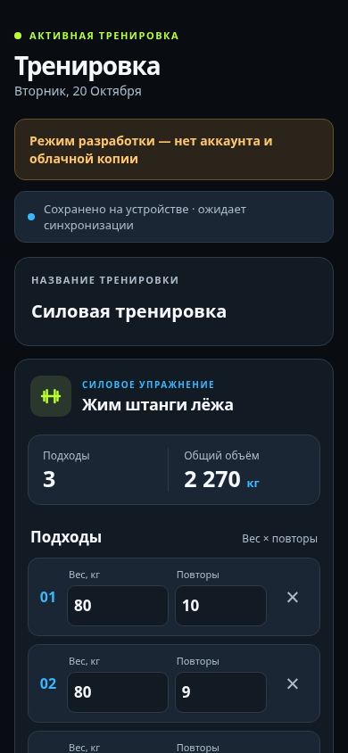

# Workout Tracker — Blueprint v0.5

**Статус:** Plan 003B в Draft PR: обязательный вход и начальная синхронизация подготовлены, закрытый пилот ещё не проверен с реальными аккаунтами. Обновлено 2026-10-20.

## Цель
Бесплатное мобильное PWA для силовых тренировок, русскоязычный интерфейс Performance Dark × Athletic Pro, запись подходов без интернета после первого входа, приватные аккаунты и синхронизация между устройствами.

## Принятые продуктовые решения
- **Авторизация обязательна** в публичной версии: отдельная история у каждого пользователя, Supabase Auth + Postgres RLS. Для **закрытого личного пилота** принят email/password без подтверждения (ADR 0007), **после регистрации владельца новые signup выключаем**. Для открытой регистрации других пользователей потребуется отдельное решение SMTP/верификации или OAuth, см. `docs/architecture/auth.md`.
- **Никакого публичного гостевого дневника.** Plan 002 использует локальный тестовый профиль только для разработки; тестовые данные не должны переноситься автоматически в реальные аккаунты.
- **Офлайн-работа обязательна до использования в зале.** Сначала локальная запись IndexedDB + outbox, затем sync в Supabase; первая регистрация/вход требуют интернет.
- Дизайн: лаймовый цвет для основных действий, голубой для аналитики, мобильный one-handed UX.
- Только бесплатные инструменты; GitHub Pages публикует frontend, а не пользовательские записи.

## Порядок работы
1. **Plan 001 IMPLEMENTED** — React + TypeScript + Vite, демонстрационный экран без Auth/IndexedDB; нельзя использовать для реальных записей.
2. **Plan 002 IMPLEMENTED** — Dexie/IndexedDB, PWA оболочка, тестовая локальная область и экспорт/импорт; не выкладывать как общедоступный сервис.
3. **Plan 003A INFRASTRUCTURE APPLIED** — Supabase Free проект создан; согласованная защищённая SQL-миграция применена и проверена по облачному каталогу. Полная авторизация, реальные A/B-тесты и синхронизация ещё не реализованы.
4. **Plan 003B IN REVIEW** — Supabase Auth, обязательный вход, личный IndexedDB workspace и первоначальные pull/push через RPC. Реальные A/B-тесты и настройка Auth владельцем остаются контрольными точками.
5. **Plan 004 PLANNED** — надёжная синхронизация, конфликты, защита от повторов, двухпользовательские и офлайн-тесты; gate закрытого личного пилота.
6. **Plan 005 BACKLOG** — графики, статистика, дополнительные функции.

## Документация
- `AGENTS.md` — короткие правила Codex.
- `ARCHITECTURE.md` — архитектура.
- `docs/product/` — требования и пользовательские сценарии.
- `docs/design/` — визуальная система и экраны.
- `docs/architecture/auth.md` — поведение авторизации и офлайн-режима.
- `docs/architecture/security.md` — RLS, secret boundaries.
- `docs/architecture/offline-sync.md` — механика синхронизации.
- `docs/architecture/decisions/0006-required-auth-private-accounts.md` — обязательные личные аккаунты.
- `docs/architecture/decisions/0007-private-pilot-unverified-email.md` — временный режим закрытого пилота без email verification.
- `docs/operations/supabase-private-pilot.md` — инструкция по настройке Supabase, без хранения секретов.
- `docs/plans/` — этапы для Codex.

## Локальный запуск Plan 003B

### Как выглядит приложение

| Личный вход Plan 003B | Экран тренировки из тестового режима Plan 002 |
| --- | --- |
|  |  |

Снимки сделаны с локальной production-сборки на ширине 390 px. В публичной версии журнал скрыт до входа; показанные три подхода относятся к тестовому режиму Plan 002 и не переносятся в личный аккаунт.

Нужен Node.js 20.19+ или 22.12+ и npm. Из корня репозитория:

```bash
npm ci
npm run dev
```

Откройте `http://localhost:5173/Workout_Tracker/`. Путь совпадает с будущим размещением на GitHub Pages. Для проверок:

```bash
npm run lint
npm run typecheck
npm test -- --run
npm run build
```

Публичная сборка показывает экран входа; без аккаунта личный журнал недоступен. Для первоначальной регистрации владелец сначала временно открывает signup в Supabase Dashboard и `Confirm Email = OFF`, затем открывает приложение с `?signup=1`. После регистрации владелец снова закрывает signup на сервере. Параметр URL лишь показывает форму и не меняет серверные правила. Восстановление пароля в закрытом пилоте не настроено. Пароль, service role и secret key в репозиторий не добавляются.

После входа пользователь видит только свою локальную область. Изменения сохраняются в IndexedDB и отправляются в Supabase при подтверждённой онлайн-сессии. Нужен ручной экспорт JSON и проверка реальной синхронизации с двумя аккаунтами до использования для настоящих тренировок.

Для проверки PWA выполните `npm run build`, затем `npm run preview`, откройте `http://localhost:4173/Workout_Tracker/` онлайн и дождитесь установки Service Worker. Первый вход всегда требует интернет; ранее вошедший пользователь может открыть свою локальную область офлайн. Dev-сервер не воспроизводит production-кеш PWA. Экспорт личных данных доступен после входа; импорт личного экспорта ещё не готов. Тестовые данные Plan 002 не переносятся автоматически в аккаунт.

Для публикации на GitHub Pages выберите **Settings → Pages → Build and deployment → Source: GitHub Actions**. Workflow собирает Vite и загружает `dist`. Исходный `index.html` в репозитории мал по размеру намеренно: React-интерфейс находится в собранном JavaScript. Если Pages публикует корень `main` через Jekyll, браузер получает ссылку на исходный `.tsx` и видит пустую страницу.

### Карта модулей

- `src/app` — экран, черновик ввода и статусы записи.
- `src/features/workout` — карточка упражнения, строки подходов и локальный статус.
- `src/domain` — проверка чисел и расчёт объёма без React.
- `src/data/ports` — интерфейс хранилища, от которого зависит экран.
- `src/data/local` — Dexie-схема, атомарные записи, outbox и резервные копии.
- `src/data/auth` — Supabase Auth и правила доступа к личной области.
- `src/data/cloud` — публичный Supabase-клиент, первоначальная загрузка и RPC-отправка.
- `src/features/auth` — форма входа и AuthGate.
- `src/shared` — кнопка, поле ввода и CSS-токены.
- `src/domain/*.test.ts` и `src/data/local/*.test.ts` — тесты расчётов и хранения.

Текущий объём вычисляется как сумма `вес × повторы` по корректно заполненным подходам. Пустые и некорректные строки пока не входят в сумму. Кнопка удаления позволяет отменить последнее удаление. Пустое или некорректное значение остаётся только в текущем черновике до исправления и явно помечается как несохранённое.

## Что осталось согласовать до Plan 003
**Решение по пилоту принято (ADR 0007):** email+password без подтверждения, реальный email владельца, после создания аккаунта отключить регистрацию. Открытая регистрация сторонних пользователей в эту версию не входит.

## Ограничения
Офлайн-режим не заменяет резервное копирование; данные IndexedDB могут исчезнуть при очистке хранилища. При выходе сохранённые локальные записи должны быть недоступны из UI. Устройство/браузер не является криптографически защищённым хранилищем без отдельной системы шифрования.
