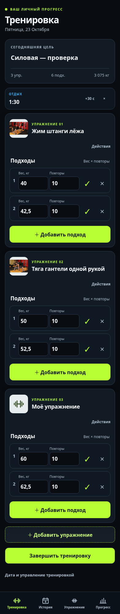
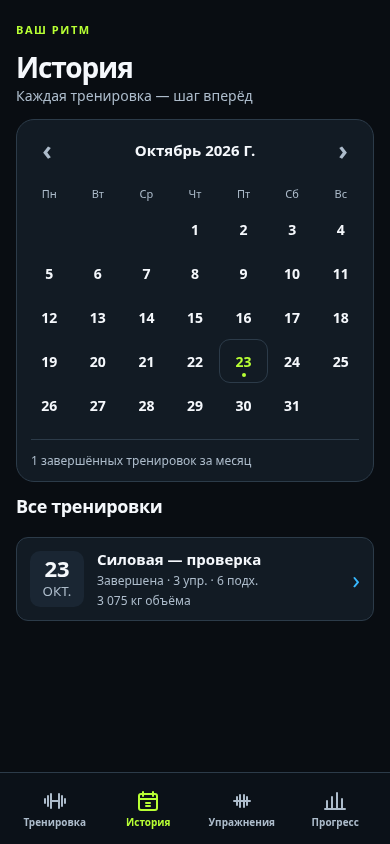
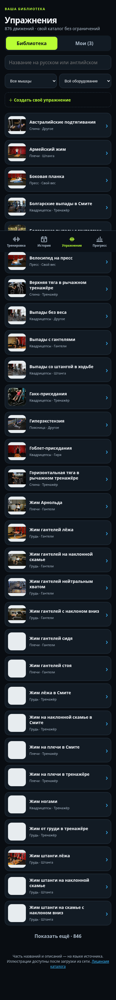

# Workout Tracker

Личный дневник силовых тренировок: React + TypeScript, Dexie, Supabase, GitHub Pages. Русский интерфейс Performance Dark × Athletic Pro, ориентированный на iPhone PWA.

**Открыть:** https://artemshlyakov.github.io/Workout_Tracker/

## Возможности

- Пустая тренировка со своим названием; несколько упражнений и независимые подходы; вес/повторы, удаление с отменой, порядок, завершение и исправление истории.
- Библиотека 876 движений, 136 русских названий, иллюстрации, поиск и фильтры; собственные упражнения. Остальные названия и инструкции пока на английском.
- Повтор состава, прошлые значения, три примера быстрого старта, таймер отдыха и сохранение незаконченного ввода на устройстве.
- Календарь, история, прогресс по упражнениям за 30/90 дней или всё время.
- Личный вход; атомарные локальные записи с outbox, RPC/CAS, повторная загрузка облака, ограниченные повторы, сравнение конфликтующих версий.
- Экспорт JSON и добавочное восстановление копии своего аккаунта. Существующий журнал не заменяется.

| Тренировка | Календарь | Библиотека |
| --- | --- | --- |
|  |  |  |

Снимки локального Chromium с тестовым owner, не свидетельство облачного браузерного теста.

## Использование

[Инструкция для iPhone и ежедневной записи](docs/operations/personal-diary.md). Установите через Safari → «Поделиться» → «На экран Домой». Первый вход требует сети. Регистрация закрытого личного пилота не расширяется; автоматическое восстановление пароля пока не настроено.

**Граница проверенности:** реальные Auth/REST/RPC/RLS/CAS и адаптерные интеграции проверены ранее; полный браузерный Auth/offline/online сценарий и физический iPhone остаются открытым gate. Локальные браузерные проверки интерфейса/IndexedDB и офлайн-shell перечислены в [PROGRESS](docs/PROGRESS.md). Не считайте устройство единственной копией: регулярно экспортируйте журнал. Удалённый в облаке родитель с локальными pending-потомками требует отдельного восстановления, а не автоматического разрешения конфликта.

## Разработка

Node.js 20.19+ или 22.12+, npm:

```bash
npm ci
npm run dev
```

http://localhost:5173/Workout_Tracker/

```bash
npm run lint
npm run typecheck
npm test -- --run
npm run build
npm run preview
```

Для локальной проверки 360/390 px нужен Python Playwright и `/usr/bin/chromium`. С работающим dev-сервером:

```bash
python scripts/check-diary-browser.py
```

Скрипт создаёт временную entry-страницу только для UI/Dexie теста и удаляет её при завершении. Не запускайте параллельно production build. Supabase не подменяется в публичном приложении, тестовые учётные записи не создаются. Production-сборка всегда открывается через AuthGate.

GitHub Actions выполняет lint/typecheck/tests/build на PR, после объединения main публикует `dist` через Pages. Источником Pages должен оставаться GitHub Actions. Секреты, JWT, пароли и service role запрещены в коде и `VITE_*`; опубликованный publishable key не секрет, доступ обеспечивают RLS и RPC.

## Документы

- [AGENTS](AGENTS.md), [Architecture](ARCHITECTURE.md), [Progress](docs/PROGRESS.md).
- [Plan 006](docs/plans/006-personal-training-release.md), [решения по данным и восстановлению](docs/architecture/decisions/0008-personal-diary-drafts-and-recovery.md).
- [Исследование Strong / Hevy / FitNotes и лицензия каталога](docs/research/training-diary-review.md).
- [Дизайн](docs/design/design-system.md), [экраны](docs/design/screens.md), [пользовательские сценарии](docs/product/user-flows.md).

Длительность/дистанция подходов, социальные функции, публичная регистрация и фоновые уведомления iOS не входят в текущий дневник. Изображения кешируются по мере просмотра; персональные API/токены не кешируются Service Worker.
