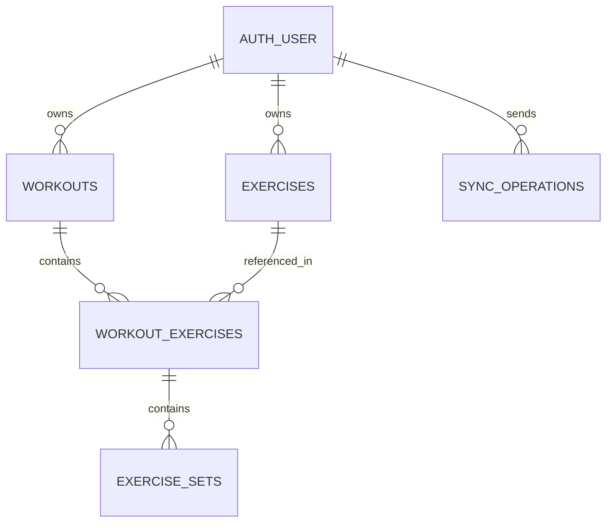

# Data model — local-first + Supabase v0.4

**Status:** the Plan 003A migration in `supabase/migrations/20261020132939_private_workout_sync.sql` was applied to project `snnlibzckwpmbkersdnm` via Supabase MCP; the local version now matches cloud history (details: `supabase/migrations/README.md`). Auth and sync remain future work. The legacy v0.2 SQL in `supabase/drafts/` remains unapproved and must never be executed.

## Logical graph

## Postgres columns (target)
All user-owned entities: `id UUID` client-generated; `user_id UUID` must equal authenticated ID; `revision BIGINT NOT NULL DEFAULT 1` server-owned; `created_at`, `updated_at` server-owned UTC, `deleted_at TIMESTAMPTZ NULL` for tombstones. Foreign keys include `(user_id, parent_id)` to prevent cross-account references. Data-specific fields:
- `workouts`: title, started_at, completed_at.
- `exercises`: name; later optional movement mode.
- `workout_exercises`: workout_id, exercise_id, position.
- `exercise_sets`: workout_exercise_id, position, weight_kg numeric(7,2), reps integer.
- `sync_operations`: `(user_id, operation_id)` unique, payload digest, stored result/revision/status; ledger prevents replay creating duplicate/overwrites.

**Security:** RLS and grants on all exposed user-owned tables. Browser direct WRITE privilege must be carefully limited if server-owned revisions are enforced by RPC; otherwise a client could forge revision/deletion timestamps and bypass conflict logic while still owning the row. Prefer narrow auth'd RPC for all synchronised writes; read via RLS-filtered views/tables. RPC security must be separately tested.

## Browser IndexedDB shape
`workspaces` (only authenticated user-scoped in public product; dev_test workspace is testing-only), `workouts`, `exercises`, `workoutExercises`, `exerciseSets`, `outbox`, `syncState`. Records keyed by `workspaceId` + UUID; ownerUserId tracks stable Supabase identity. `serverRevision` nullable before initial push; independent `localRevision` increments per edit. `operationId` stable across retries. Never store secrets in outbox. Email/display_name is not an ownership key. Plan 002 dev-only local records are not promoted to real account implicitly.

## Integrity and values
- Weight in kg as fixed decimal or integer centi-kg internally; avoid JS floating errors in persisted rounding. `0..2000`, max 2 decimals. Reps positive integer `1..1000`.
- `weight * reps` for external load only. No false bodyweight volume semantics.
- Validation at UI, domain and SQL boundary.
- UTC timestamps for storage, locale time for display; client timestamps are not conflict clocks.
- Sort by explicit `position` then UUID if needed. Multiple workout exercises can share a catalog exercise.

## Deletion and snapshot safety
Hard deletes with cascade can destroy offline edits on other devices. Implement tombstones (`deleted_at`) + revision for synchronised mutable entities and a documented cleanup policy. Avoid unbounded operation log growth; ledger retention must remain sufficient for retry horizon and conflict safety. Do not physically purge tombstones automatically in MVP.

## Migration strategy
1. Keep 0001 as unexecuted *legacy draft*; when Plan 003 begins, either replace with complete initial schema if never deployed, or add additive migration if deployed.
2. Design server-side mutation RPC/transaction with per-user op ledger; test replay with changed payload, conflict, foreign-key and cross-user attempts.
3. Test `anon`, User A and User B read/write/error paths using actual Supabase/Postgres integration harness. Do not report schema verified without executing tests.
